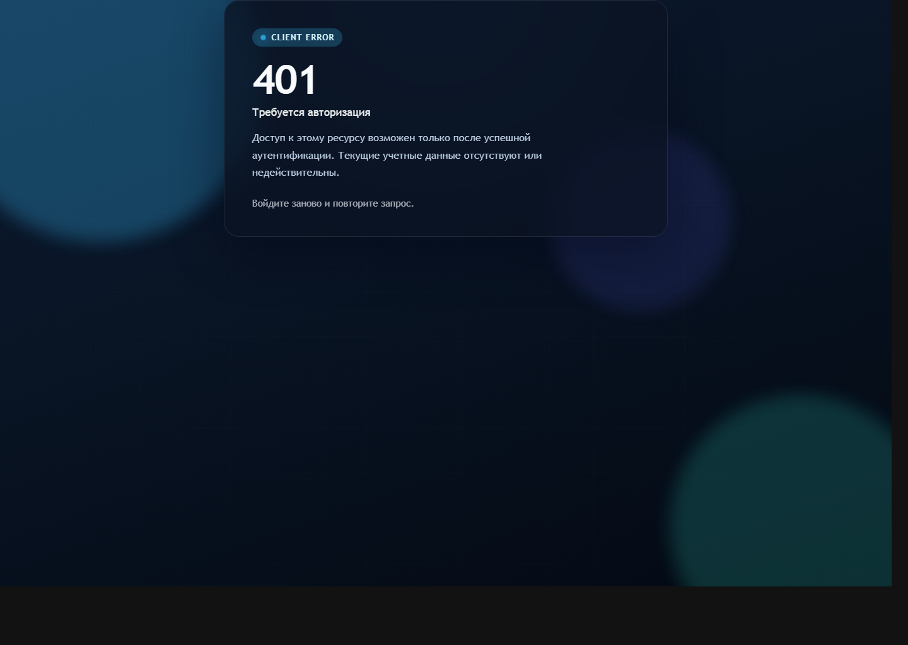
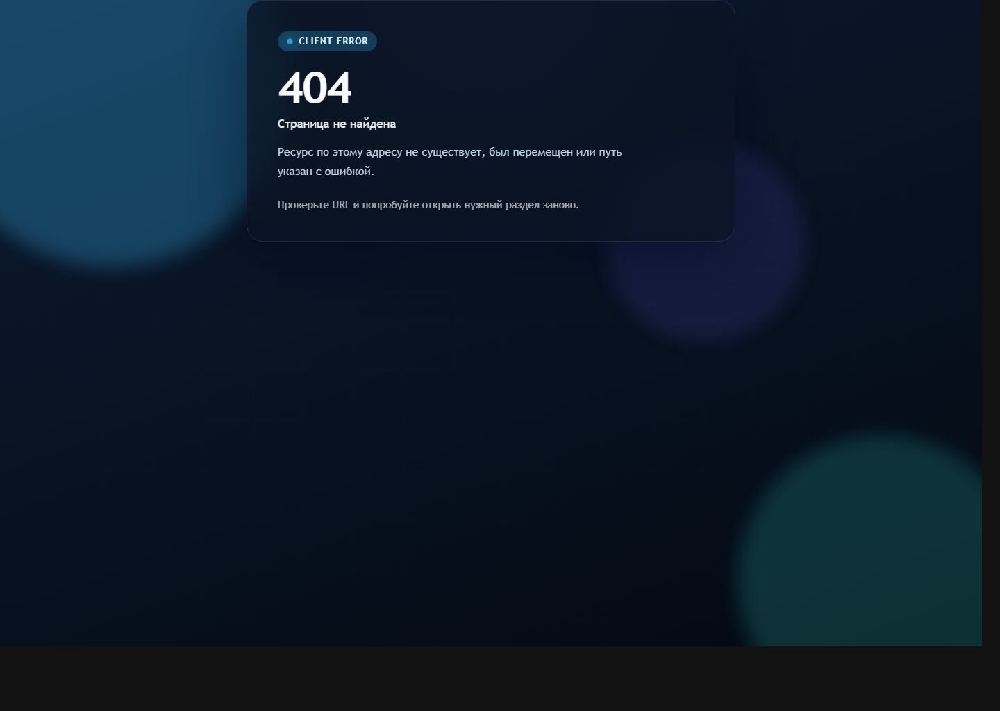
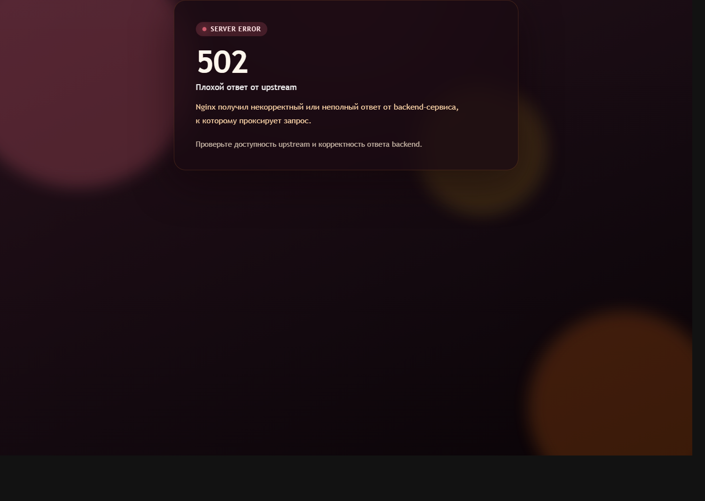
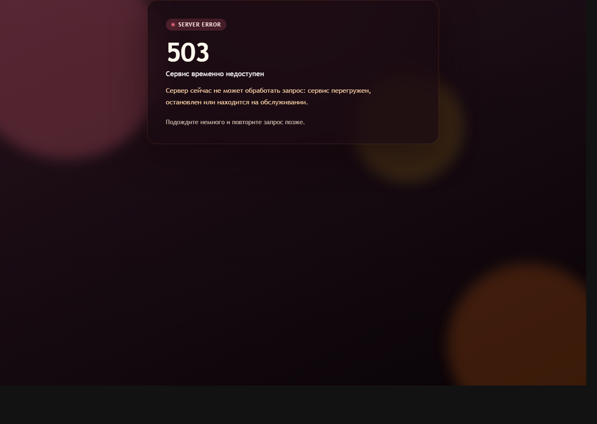
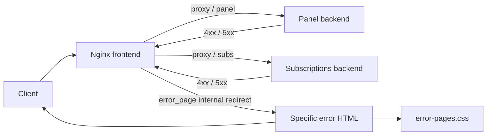

# 3xui-fallback

[](https://nginx.org/)
[](https://docs.docker.com/compose/)
[](#supported-errors)

Легковесный nginx-фронт для 3x-ui с кастомными fallback-страницами ошибок. Проект проксирует трафик на два backend-сервиса и подменяет стандартные nginx error pages на собственные HTML-шаблоны с общей анимацией и понятными сообщениями.

## Contents

- [Overview](#overview)
- [Preview](#preview)
- [Supported Errors](#supported-errors)
- [Request Flow](#request-flow)
- [Quick Start](#quick-start)
- [Mosquito Swatter](#mosquito-swatter)
- [Project Structure](#project-structure)

## Overview

Что есть в проекте:

- `docker-compose.yml` для запуска nginx в `host` network
- `nginx.conf` как шаблон с `envsubst`
- отдельные HTML-страницы для `400`, `401`, `403`, `404`, `405`, `500`, `502`, `503`, `504`
- общий `html/error-pages.css` с легкой фоновой анимацией
- примеры реальных экранов в `docs/screenshots/`

Проект рассчитан на два upstream backend:

- панель
- подписки

## Preview

<p>
  
  
</p>
<p>
  
  
</p>

## Supported Errors

| Code | Meaning | Template |
| --- | --- | --- |
| 400 | Bad Request | `html/400.html` |
| 401 | Unauthorized | `html/401.html` |
| 403 | Forbidden | `html/403.html` |
| 404 | Not Found | `html/404.html` |
| 405 | Method Not Allowed | `html/405.html` |
| 500 | Internal Server Error | `html/500.html` |
| 502 | Bad Gateway | `html/502.html` |
| 503 | Service Unavailable | `html/503.html` |
| 504 | Gateway Timeout | `html/504.html` |

## Request Flow



Ключевая механика:

```nginx
proxy_intercept_errors on;
error_page 401 /401.html;
error_page 404 /404.html;
error_page 502 /502.html;
error_page 503 /503.html;
```

HTML-файлы лежат в `/usr/share/nginx/html`. Сами страницы ошибок отдаются только через внутренний редирект nginx, а общий CSS доступен отдельно, чтобы браузер мог загрузить стили.

## Quick Start

1. Создайте `.env` на основе `.env.example`.
2. Заполните домен, HTTPS-порты, backend-адреса и пути к сертификатам.
3. Задайте `PANEL_ALLOWED_CIDR` для сети, из которой можно открывать панель.
4. Задайте path prefixes для панели и подписок.
5. Если backend-сервисы слушают только `127.0.0.1` на хосте, оставьте `PANEL_BACKEND_HOST=127.0.0.1` и `SUBS_BACKEND_HOST=127.0.0.1`.
6. Запустите контейнер:

```bash
docker compose up -d
```

Что происходит при старте:

- переменные окружения подставляются в `nginx.conf`
- итоговая конфигурация проверяется через `nginx -t`
- nginx запускается в foreground-режиме

## Environment Variables

Основные настройки берутся из `.env`:

- `SITE_DOMAIN`
- `PANEL_HTTPS_PORT`
- `SUBS_HTTPS_PORT`
- `PANEL_ALLOWED_CIDR`
- `PANEL_PATH_PREFIX`
- `SUBS_PATH_PREFIX`
- `PANEL_BACKEND_HOST`
- `PANEL_BACKEND_PORT`
- `PANEL_BACKEND_SCHEME`
- `PANEL_BACKEND_TLS_NAME`
- `PANEL_BACKEND_SSL_VERIFY`
- `SUBS_BACKEND_HOST`
- `SUBS_BACKEND_PORT`
- `SUBS_BACKEND_SCHEME`
- `SUBS_BACKEND_TLS_NAME`
- `SUBS_BACKEND_SSL_VERIFY`
- `SSL_CERT_FULLCHAIN_PATH`
- `SSL_CERT_PRIVKEY_PATH`

Для путей используйте формат:

- с ведущим `/`
- без завершающего `/`

Пример:

```env
PANEL_PATH_PREFIX=/super_duper_proxy_panel
SUBS_PATH_PREFIX=/comrades
PANEL_ALLOWED_CIDR=127.0.0.1/32
PANEL_BACKEND_HOST=127.0.0.1
SUBS_BACKEND_HOST=127.0.0.1
PANEL_BACKEND_SCHEME=http
SUBS_BACKEND_SCHEME=http
PANEL_BACKEND_TLS_NAME=127.0.0.1
SUBS_BACKEND_TLS_NAME=127.0.0.1
PANEL_BACKEND_SSL_VERIFY=off
SUBS_BACKEND_SSL_VERIFY=off
```

`PANEL_ALLOWED_CIDR` применяется только к panel proxy. Безопасный пример `127.0.0.1/32` оставляет панель доступной только локально. Для админской сети укажите ее CIDR, например `203.0.113.0/24`. Значение `all` открывает панель публично и должно использоваться только если внешний firewall, VPN или другой access gate уже enforced вне этого контейнера.

Клиенту вне `PANEL_ALLOWED_CIDR` панель отвечает обычной `404`, как любой несуществующий путь, а редирект `PANEL_PATH_PREFIX` → `PANEL_PATH_PREFIX/` выдается только разрешенным адресам. Так по ответам нельзя подобрать скрытый путь панели. Панель принимает тело запроса до 50 МБ, чтобы работал импорт `x-ui.db`.

Если panel backend на `127.0.0.1:19000` сам поднимает TLS и отвечает только по `https`, укажите:

```env
PANEL_BACKEND_SCHEME=https
```

Иначе nginx будет ходить к backend по `http`, а backend начнет отвечать `307 Temporary Redirect` на тот же внешний URL панели.

Для HTTPS upstream nginx может проверять сертификат backend через CA bundle контейнера и использует `PANEL_BACKEND_TLS_NAME` / `SUBS_BACKEND_TLS_NAME` как TLS identity. Это позволяет подключаться к backend по `127.0.0.1`, но проверять сертификат по доменному имени из SAN. Например, если backend доступен на `127.0.0.1:19000`, а сертификат выпущен на `example.com`, задайте `PANEL_BACKEND_HOST=127.0.0.1`, `PANEL_BACKEND_TLS_NAME=example.com` и `PANEL_BACKEND_SSL_VERIFY=on`. Self-signed/private CA нужно доверить контейнеру. Для локального HTTPS backend с self-signed сертификатом можно оставить `PANEL_BACKEND_SSL_VERIFY=off`; для локального backend без TLS оставляйте `PANEL_BACKEND_SCHEME=http` / `SUBS_BACKEND_SCHEME=http`.

Для страницы подписок location должен проксировать не только `/SUBS_PATH_PREFIX/<subid>`, но и вложенные пути вида `/SUBS_PATH_PREFIX/<subid>/...`, потому что `3x-ui` подгружает ассеты страницы относительно динамического `subid`. Поэтому в шаблоне nginx используется префиксный `location ${SUBS_PATH_PREFIX}/`.

Некорректные `subid`, на которые backend отвечает `400` или `404`, тоже подхватываются `error_page` и показывают кастомную страницу вместо сырого `Error!`.

## Mosquito Swatter

Обычный Compose запускает fallback без событий Swatter. Чтобы включить их, добавьте override:

```sh
docker compose -f docker-compose.yml -f compose.swatter.yml up -d
```

Оба TLS-входа пишут в stdout контейнера `3xui-fallback` строки `moskit.http.v1` с временем, адресом соединения, методом, меткой пути и итоговым статусом. `/.env`, `/.git/config`, `/wp-login.php` и `/xmlrpc.php` сохраняются как фиксированные метки даже после внутреннего перехода на страницу ошибки. Метка ставится на любой глубине пути: `/subs/.env` пишется как `/.env`, без префикса. Остальные пути получают одну метку `/_other`. Из этого журнала можно считать запросы, но нельзя восстановить или посчитать разные неизвестные пути. Query, токены подписок, `Host`, `X-Forwarded-For`, cookies и другие заголовки в этот поток не попадают. Существующие access и error logs работают отдельно со своими форматами.

Override включает неблокирующую доставку и ротацию Docker `local`. При переполнении буфера часть записей может потеряться. Docker хранит эти журналы на уровне контейнера. Если история нужна после его пересоздания, сохраняйте её через доверенный сборщик.

Для разовой проверки под учётной записью с доступом к Docker:

```sh
docker logs 3xui-fallback | jq -Rrc 'fromjson? | select(.schema == "moskit.http.v1")'
```

Для постоянного сбора копируйте новые строки в файл systemd-сервисом. `docker logs` отдает только сами сообщения, без обертки драйвера Docker, поэтому строки в файле — готовый JSONL:

```ini
# /etc/systemd/system/3xui-fallback-swatter.service
[Unit]
Description=Copy 3xui-fallback Swatter events to a file
After=docker.service
Requires=docker.service

[Service]
ExecStartPre=/usr/bin/mkdir -p /var/log/swatter
ExecStart=/bin/sh -c 'docker logs -f --tail 0 3xui-fallback 2>/dev/null | grep --line-buffered -F moskit.http.v1 >> /var/log/swatter/3xui-fallback.jsonl'
Restart=always
RestartSec=5

[Install]
WantedBy=multi-user.target
```

```sh
systemctl daemon-reload
systemctl enable --now 3xui-fallback-swatter
```

Когда контейнер пересоздается, `docker logs -f` завершается, и systemd перезапускает сервис через 5 секунд. Записи за эти секунды в файл не попадут. Ротация файла через logrotate:

```text
# /etc/logrotate.d/3xui-fallback-swatter
/var/log/swatter/3xui-fallback.jsonl {
    daily
    rotate 7
    compress
    missingok
    notifempty
    copytruncate
}
```

Добавьте в `sources` Swatter объект с этим путём:

```json
{"id":"fallback_http","type":"file","path":"/var/log/swatter/3xui-fallback.jsonl","parser":"nginx_json","service":"fallback","nft_eligible":false,"trusted_success":false,"options":{"log_visits":true}}
```

Профиль работает в режиме наблюдения (`nft_eligible: false`): Swatter учитывает события, но не блокирует адреса.

## Project Structure

```text
.
├── .env.example
├── .gitignore
├── README.md
├── docker-compose.yml
├── nginx.conf
├── docs/
│   └── screenshots/
│       ├── 401.png
│       ├── 404.png
│       ├── 502.png
│       └── 503.png
└── html/
    ├── error-pages.css
    ├── 400.html
    ├── 401.html
    ├── 403.html
    ├── 404.html
    ├── 405.html
    ├── 500.html
    ├── 502.html
    ├── 503.html
    └── 504.html
```

## Dependency maintenance

The Compose image and both regression tests use nginx 1.30.6 on Alpine 3.24, pinned by digest. Update all three references together after reviewing nginx advisories and rerunning the tests. For an existing installation, pull the new image before recreating the service: `docker compose pull && docker compose up -d`. Back up your configuration and retain the previous image for rollback.
